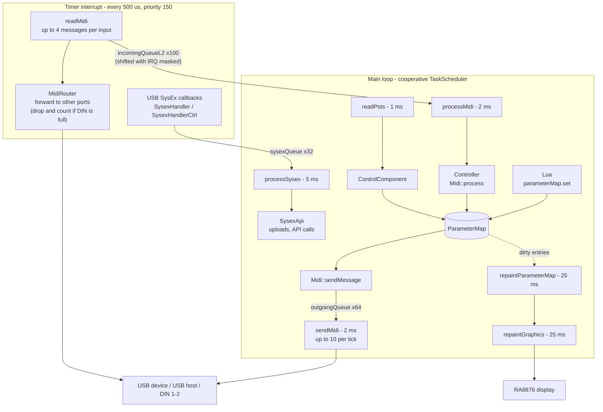
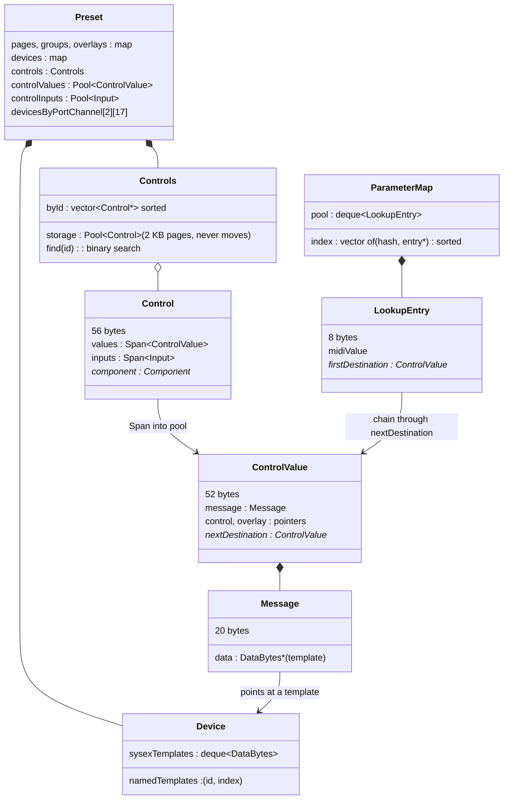
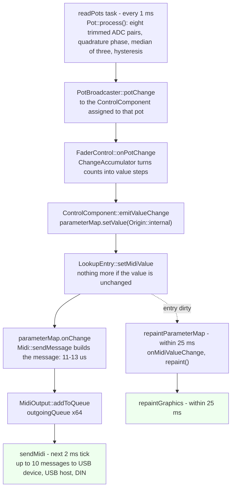
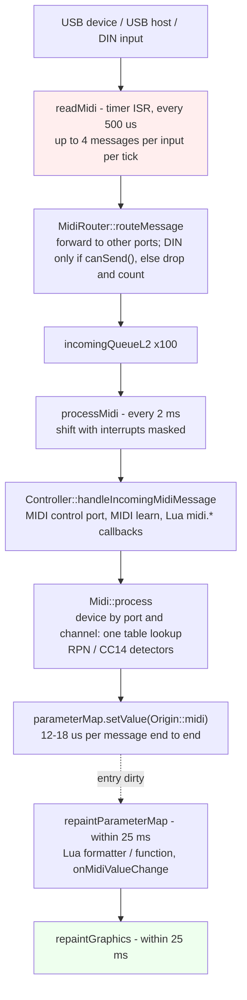
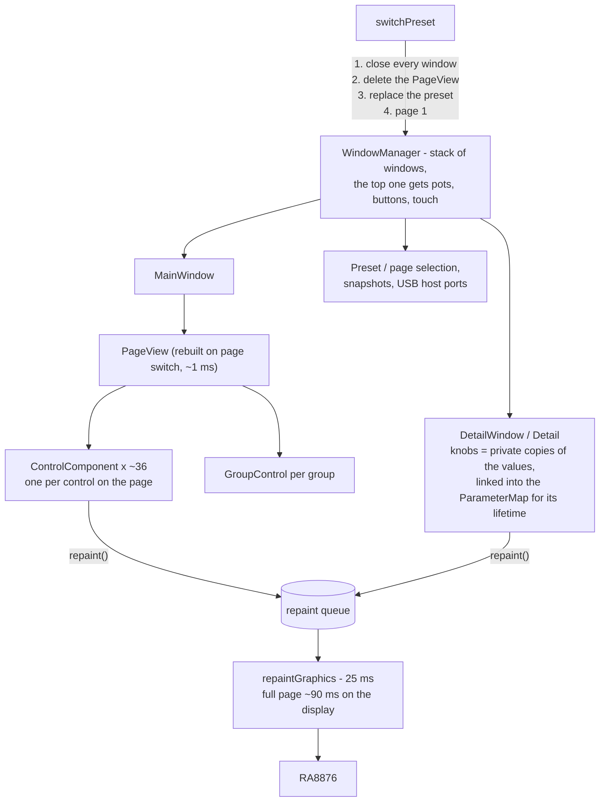

# Electra One mk1 firmware — system architecture

How the instrument is put together at runtime: what runs when, on which
context, through which queues, and where the time and memory go. Numbers
are measurements on the bench unit (MK66FX1M0 at 180 MHz, SD card in 1-bit
mode, the 362-control Access Virus TI preset loaded) with the `PROFILE`
build, see *Measuring* at the end.

## 1. Hardware and the two memories

| Part | Role |
|---|---|
| MK66FX1M0 (Cortex-M4F, 180 MHz) | Everything runs here. 1 MB flash, 256 KB SRAM in two banks: SRAM_L below `0x20000000` on the code bus, SRAM_U above it on the system bus. One access must not straddle the boundary (it hard faults in `memcpy`). |
| RA8876 display controller | Drives the 1024×600 panel over SPI and owns a large SDRAM. The firmware uses that SDRAM for more than pixels: the font atlases, the label/string store (`VramStore`), bitmaps, and the SysEx memory pool all live there. |
| SD card (SDHC, `SdFat`) | Presets (`ctrlv2/pNNN.epr`), Lua scripts, parameter-map state, snapshots, screenshots. The bench unit runs it in 1-bit mode (`SD_FORCE_1BIT_BUS=1`), roughly a quarter of the normal rate. |
| USB device (3 cables) | Port 1, Port 2 and the CTRL cable the host editor and the CLI talk to. |
| USB host | Up to two class-compliant MIDI devices. |
| Two DIN UARTs | MIDI 1/2 in and out at 31 250 baud, 256-byte transmit buffers. |
| 12 pots, 12 touch sensors, 6 buttons, LCD touch | Read by polling tasks; the pots through the ADC and a multiplexer, touch over I²C. |

SRAM is the scarce resource. The production image has 59 KB of static
data (`.data` + `.bss`); the largest static objects are the incoming MIDI
queue (11.6 KB), the outgoing queue (7.4 KB), the two DIN MIDI parsers
(4.4 KB each) and the SysEx transfer queue (3.3 KB). Everything a preset
needs is heap. The heap may not grow past `sp - 8 KB` (`_sbrk` in
`bsp/mk66fx1m0.c`), and `RamMonitor` (`src/Hardware/RamMonitor.h`) watches
the stack with markers; `adj_free()` is free heap plus the gap between the
heap top and the deepest stack seen. `Presets::loadPreset` refuses a preset
that leaves less than 62 000 bytes of `adj_free()` after its model is built,
because Lua and the page components come after that.

## 2. Execution contexts

There is no RTOS. Three contexts exist, and knowing which one a piece of
code runs on is most of what there is to know about concurrency here.

### 2.1 The main loop — cooperative tasks

`main()` calls `System::tasks.execute()` forever. `SystemTasks`
(`src/System/SystemTasks.cpp`) is a TaskScheduler with these tasks:

| Task | Period | What it does |
|---|---|---|
| `readPots` | 1 ms | Reads the pot the multiplexer has rested on for a tick, emits a `PotEvent` if it moved, and reads the button sharing that address. Every pot is read in turn; one that moved in the last 250 ms gets every other tick. About 80 µs a reading. |
| `readPotTouch` | 10 ms | Polls the capacitive sensor chip when it flags a change; emits touch down/up. Touch no longer decides which pots are read, only how wide their backlash gate is. |
| `readButtons` | 15 ms | Six buttons, only while the controller sleeps; otherwise `readPots` reads them. |
| `readLCDTouch` | 40 ms | Panel touch over I²C; dispatches touch events to components. |
| `processMidi` | 2 ms | Drains the incoming queue (L2) into the application. |
| `sendMidi` | 2 ms | Sends up to ten messages from the outgoing queue. |
| `processSysex` | 5 ms | Drains the SysEx transfer queue: preset uploads, API calls, file requests. |
| `repaintGraphics` | 25 ms | Paints everything in the repaint queue. |
| `refreshMidiIndicators` | 100 ms | Status-bar MIDI activity marks. |
| `userTask` | 250 ms | Sends queued patch requests; performs a pending preset switch. |
| `runTimer` | script-defined | The Lua `timer` module. |
| `scanUSBHost` | 2 s | Enumerates USB host devices. |
| `collectGarbage` | 10 s | Lua GC step. |
| `monitorFreeMemory` | 10 s | Disabled in production; in the `PROFILE` build it logs the profile. |
| `repaintParameterMapTask` | 25 ms, while a page is shown | Walks the parameter map for dirty entries and repaints their components. |

Tasks run to completion, one after another. Nothing on the main loop
preempts anything else on the main loop, so main-loop code needs no locks
against main-loop code. What it does need is to be short: a task that takes
90 ms (a full page repaint) delays every other task by 90 ms.

### 2.2 The MIDI timer interrupt

`timerReadMidi` (an `IntervalTimer`, priority 150) calls `readMidi()`
every 500 µs. That routine, in `src/System/TaskReadMidi.cpp`, is the only
place MIDI comes in. Per tick it reads up to four messages from each
input (USB device, two USB host ports, two DIN ports), and for each one:

1. runs the router (`MidiRouter::routeMessage`), which copies the message
   to the other ports the configuration asks for;
2. pushes it onto the incoming queue L2 for `processMidi`.

That is all the interrupt does with a channel message. It used to do more:
MIDI clock was dispatched from here straight into the application and the
Lua script, for latency. That put `lua_pcall` and heap allocations inside an
interrupt while the main loop could be in the same interpreter and the same
allocator, and the clock now goes through the queue with everything else,
at most 2 ms later.

The USB stack's SysEx callbacks also fire from this interrupt
(`usb_midi_read` calls the partial-SysEx handler as bytes arrive). For the
data cables they feed `SysexHandler`, which assembles a `SysexBlock` in the
SysEx memory pool; for the CTRL cable `SysexHandlerCtrl` assembles the
transfer — writing large ones straight to a temporary file on the card —
and pushes a `SysexTransport` onto `sysexQueue` when it is complete. During
a CTRL transfer the timer is switched to `readCtrlMidi` at 6 µs so the
upload is not throttled by the 500 µs tick.

**What the interrupt may not do.** Wait. The DIN transmit buffer holds 85
messages and the line then drains one per millisecond; a router forwarding a
600-message burst from USB to DIN used to block here for a millisecond per
message, which starved the main loop and overflowed L2 — 191 of the 600
reached the application. The router now asks `MidiOutput::canSend()` and
drops, counting in `MidiRouter::droppedToMidiIo`, what the line has no room
for. The forward to USB (`usb_midi_write_packed`) can still spin for a
bounded time when the host is not polling; that is a known cost, not a
fixed one.

### 2.3 Other interrupts

`timerSpinner` (priority 255) animates the boot spinner. The UART, USB, I²C
and SysTick interrupts belong to the BSP. None of them run application
code.

## 3. Queues between the contexts

| Queue | Element | Depth | Producer → consumer | Discipline |
|---|---|---|---|---|
| `incomingQueueL2` | `MidiMessageTransport` (116 B) | 100 | timer ISR → `processMidi` | The consumer shifts with interrupts masked: `CircularBuffer` keeps one `count` both sides update, and two unmasked updates can interleave and leave it off by one for good. On overflow the buffer overwrites its oldest entry. |
| `sysexQueue` | `SysexTransport` (104 B) | 32 | USB SysEx callback (ISR) → `processSysex` | Same masked shift. |
| `MidiOutput::outgoingQueue` | `MidiMessageTransport` | 64 | main loop → `sendMidi` | Single context, no masking. When full, `addToQueue` sends a tick's worth synchronously instead of overwriting the oldest entry, so a script sending a bank of values loses none. |
| `patchRequests` | `PatchRequest` | 32 | main loop → `userTask` | Single context. |
| repaint queue | `RepaintRequest` (component pointer or area) | vector | main loop → `repaintGraphics` | A component removes itself from the queue in its destructor. |

A `MidiMessageTransport` is 116 bytes because a `MidiMessage` carries a
`SysexBlock`, which keeps the first 56 bytes of a SysEx message in RAM so
short messages — every templated SysEx a knob sends — never touch the
display's SDRAM. A slimmer queue element with the SysEx blocks held aside
would cut 5 KB of static RAM and allow a deeper queue; the copies themselves
cost nothing measurable.

## 4. The data model

A preset (`apps/controller/src/Model/`) is loaded from JSON into:

- `Pages` and `Groups` — `std::map`s, few entries.
- `Devices` — `std::map<id, Device>`; each `Device` owns its SysEx templates
  in a `std::deque<DataBytes>` (stable addresses, 16-bit ids for the ones a
  preset names) and its patch requests and responses. A
  `devicesByPortChannel[2][17]` table answers "which device listens on this
  port and channel" in one lookup for every incoming message.
- `Controls` — `Controls.h`: the controls live in a paged `Pool` (2 KB
  pages, objects never move) behind a sorted pointer index, so
  `getControl(id)` is a binary search over four bytes an entry and a
  component may keep a pointer to its control.
- Values and inputs — pooled the same way (`Pool<ControlValue, 2048>`,
  `Pool<Input, 512>`); a `Control` holds a `Span` (pointer and count) into
  them, so the code reading `control.values[i]` never changed.
- `Overlays` — `std::map<id, Overlay>`; an overlay's items are eight bytes
  each, their labels living in the display's memory behind a handle.

Object sizes on this target: `Control` 56, `ControlValue` 52, `Message` 20,
`Input` 1, `ListDataItem` 8, `LookupEntry` 8. The Access Virus preset —
362 controls, 374 values, 269 SysEx templates, 1 024 overlay items — costs
82 KB of heap as a model; the same preset cost 134 KB when every object was
a map node with its own heap block, which is why it did not load.

### 4.1 The parameter map

`ParameterMap` (`Model/ParameterMap.cpp`) is the hub between MIDI and the
screen. It maps `(device, message type, parameter number)` to a
`LookupEntry` holding the current MIDI value. The index is a sorted vector
of eight-byte `{hash, entry*}` records, searched by `std::lower_bound`; the
entries live in a `std::deque` so pointers to them stay valid while the
index grows. An entry knows the values it drives through an intrusive
chain: each `ControlValue` carries `nextDestination`, and a value listens to
exactly one parameter, so one link is enough.

A change arrives through `setValue(entry, midiValue, origin)`:

1. `LookupEntry::setMidiValue` — false if unchanged, so nothing below runs
   for a repeated value;
2. `parameterMap.onChange` (set in `ControllerApp.cpp`): for an origin
   other than MIDI-in or the map file, `Midi::sendMessage` builds and
   queues the MIDI message; then the Lua `parameterMap.onChange` callback,
   if the script has one;
3. the entry is marked dirty. `repaintParameterMapTask` (25 ms) walks the
   index, and for each dirty entry calls the value's Lua formatter and
   function if it has them and `ControlComponent::onMidiValueChange` on the
   component showing it, which schedules a repaint.

Display updates are therefore batched at 40 Hz whatever the MIDI rate.

## 5. The hot paths, measured

### 5.1 A knob step

`readPots` (1 ms) → `Pot::process` (eight trimmed ADC pairs, quadrature
phase, median of three, hysteresis) → `PotBroadcaster::potChange` → the listener registered for
that pot (`ControlComponent`, via `assignPot`) → `FaderControl::onPotChange`
→ `ChangeAccumulator` turns raw counts into value steps →
`emitValueChange` → `parameterMap.setValue(…, Origin::internal)` → the
chain in 4.1 → `Midi::sendMessage` → `MidiOutput::addToQueue`.

**30 µs average, 73 µs worst**, from the pot event to the message queued
and the repaint scheduled, on the Access Virus preset. `Midi::sendMessage`
alone is 11–13 µs for a CC and about the same for a templated SysEx.
Before this round it copied the whole `Device` — 269 SysEx templates, a heap
allocation each — on every step.

The pot scan itself bounds the rate: one pot per 1 ms tick, and a knob that
is moving gets every other tick, so a single knob produces at most 500
events a second, and the message goes out on the
next `sendMidi` tick, within 2 ms.

### 5.2 An incoming MIDI message

Timer ISR (`readMidi`, **1–2 µs average, 309 µs worst** per tick, the worst
being a tick that also ran SysEx callbacks) → L2 → `processMidi` →
`Controller::handleIncomingMidiMessage` → `Midi::process` →
`parameterMap.setValue(…, Origin::midi)` → dirty entry → repaint within
25 ms.

**12–18 µs average, 73 µs worst** per message in `processMidi`, including
the RPN and CC14 detectors. A burst of 2 000 CCs from the host arrives
complete. The USB input ceiling is now 4 reads per tick, 8 000 messages a
second; it was one per tick, 2 000 a second, before this round.

### 5.3 A message from Lua

`parameterMap.set(…)` from a script takes the same path as a knob from
step 2 of 4.1 on. A loop of 600 `set` calls delivers all 600, at
**1 220 messages a second** on the wire. That rate is the DIN line: a
device declared on "port 2" sends to DIN 2, USB device cable 2 and USB host
port 2 alike (`MidiAll`), and once the 256-byte UART buffer is full each
`Serial.write` waits for line time. The main loop waits with it, which is
why `sendMessage` averaged 708 µs and peaked at 9.3 ms inside that burst.
A script that sends a whole patch in one go should expect that; a knob
never gets near it.

### 5.4 A page switch

`MainWindow::displayPage` deletes the `PageView`, builds a new one (walks
the 362 controls, creates the ~36 components of the page, assigns pots) and
enables the parameter-map repaint task: **0.8–1.7 ms**. Then the repaint
task paints the page: **88–93 ms** for a full page of 36 controls — the
display, not the CPU. During those 90 ms `readMidi` skips its reads
(`System::repaintActive`); the USB stack buffers.

### 5.5 A preset load

`Presets::loadPreset` → `Preset::load` (parse) → default values into the
parameter map: **1.7–2.25 s**, of which the JSON parse is 2.1 s on this
unit's 1-bit card. The parser reads the file several times over — each
control's block is scanned once for the control, again for its values,
again for its inputs, one `deserializeJson` per value — so it is bound by
`Stream::find` byte reads and card sectors, not by the model. A healthy
4-bit card is faster; a single-pass parser would be faster still.

### 5.6 Incoming SysEx matched against templates

`Midi::processSysex` tries every template of every device against the
block: **24 µs average** for a short message against 269 templates (most
fail at the first differing byte), 260 µs for the long ones at boot.

## 6. Windows, components, repainting

`WindowManager` keeps a stack of `Window`s; the top one is active and gets
the pot, button and touch events. `MainWindow` owns the `PageView`, whose
children are one `ControlComponent` per control on the page and one
`GroupControl` per group. Popup windows — `DetailWindow`, preset and page
selection, snapshots, USB host ports — go on top and come off with
`Window::close`.

A `Detail` shows one control large with a knob per value. The knobs are
private copies of the control's values in a `std::list<Knob>` (a list so
that nothing moves), each linked into the parameter map for the detail's
lifetime and unlinked in `tearDownKnobs()`. With the Access Virus preset,
Lua and page 1 resident, opening an envelope detail costs about 1 % of RAM
and gives it back on close.

`Component::repaint()` queues the component; `repaintGraphics` paints
queued components into the display's back layer and flips. A component
removes itself from the queue in its destructor, and `PageView`'s destructor
clears the window's pot-touch bookkeeping, so a page switch under a held
knob leaves no pointer behind.

**Lifetime rules that matter.** Everything on screen holds references into
the preset — a detail holds the `Control` it shows — so `switchPreset`
closes every window and deletes the page *before* the preset is replaced.
Lua scripts receive `ControlValue` and `Control` as light userdata; a
script that keeps one across a preset switch keeps a dangling pointer, and
nothing in the runtime can tell it so.

## 7. Lua

One `lua_State` per loaded preset (`initLua`/`closeLua` in
`Presets::runPresetLuaScript`), on the main loop only. Callbacks into the
script: `parameterMap.onChange` per change; value formatters and functions
from the repaint task; `midi.*`/`transport.*` handlers from `processMidi`;
`preset.onLoad/onReady/onExit`; timers from `runTimer`; control paint,
touch, pot and switch callbacks from the components. Every call goes
through `lua_pcall` with the error logged at `LOG_LUA`. Formatters and
functions are looked up by name in `_G` on each call — about a
microsecond, interned strings.

## 8. Host protocol

The CTRL cable carries the Electra SysEx API (`SysexApi`,
`SYSEX-API.md`). Requests are assembled on the interrupt, handled on
`processSysex`, and answered on the same cable — a reply carries the
request's command byte. Presets and scripts upload as files to the card and
are then loaded; `runCommand` (`08 13 <name or JSON>`) executes any of the
instrument's commands (`Commands.inc`), which is how a host opens a detail
or switches a page. The logger shares the cable, so a file fetch with the
logger on fails; turn it off first.

## 9. Measuring

Build with `OPTIONS="-Wno-deprecated-declarations -DPROFILE=1"
BUILDDIR=build-prof`. `src/System/Profile.h` wraps the paths above in
DWT cycle counts and the ten-second monitor task logs count, average,
worst and best per probe at `LOG_ERROR`. `profileSyntheticPotSteps` and
`profileSyntheticPotId` (written over J-Link) turn a knob without a hand
on it. Enable the logger at level 1 (`F0 00 21 45 7F 7D 01 01 F7`) and
listen with `receivemidi ts dev "Electra Controller Electra CTRL"`.

Related documents: `SYSEX-API.md`, `LUA-API.md`, `COMMANDS.md`, `POTS.md`,
`tools/compat/README.md`.
